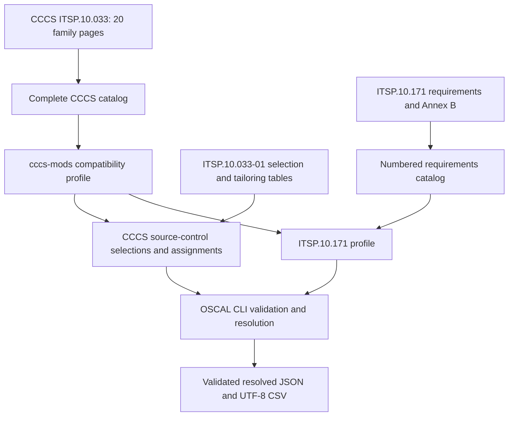

# CCCS OSCAL Samples

This repo contains unofficial implementations of security control profiles from the [Canadian Centre for Cyber Security](https://cyber.gc.ca/en) (CCCS), expressed using the [Open Security Controls Assessment Language](https://pages.nist.gov/OSCAL/) (OSCAL) 1.2.3.

For an introduction to key OSCAL concepts, please see the [documentation](https://pages.nist.gov/OSCAL/learn/concepts/terminology/).

## Authoritative sources and coverage

Version 2.0.0 replaces the incomplete NIST modifications overlay with the published Canadian catalog. It does not invent statements or substitute US requirements for Canadian requirements.

| Resource | Publication | Coverage |
|---|---|---|
| [CCCS catalog](imports/cccs-control-catalog/cccs-control-catalog.json) | [Security and privacy controls and assurance activities catalogue (ITSP.10.033)](https://www.cyber.gc.ca/en/guidance/cyber-security-privacy-risk-management/itsp10033), March 31, 2026 | All 20 families: 1,059 active controls, activities and enhancements, plus 189 withdrawn records |
| [Medium-impact profile](profiles/cccs-itsp.10.033-01-profile/cccs-itsp.10.033-01-profile.json) | [Suggested organizational security and privacy control and activity profile - Medium impact (ITSP.10.033-01)](https://www.cyber.gc.ca/en/guidance/cyber-security-privacy-risk-management/suggested-organizational-security-privacy-control-activity-profile-medium-impact-itsp10033-01), April 2, 2026 | All 380 Selected entries and 37 organization-wide PM entries; includes published profile descriptions, suggested placeholder values and profile-specific notes |
| [Specified-information requirements catalog](imports/cccs-itsp.10.171-catalog/cccs-itsp.10.171-catalog.json) and [profile](profiles/cccs-itsp.10.171-profile/cccs-itsp.10.171-profile.json) | [Protecting specified information in non-Government of Canada systems and organizations (ITSP.10.171)](https://www.cyber.gc.ca/en/guidance/protecting-specified-information-non-government-canada-systems-and-organizations-itsp10171), October 28, 2025 second release | All 99 active numbered requirements, 32 withdrawn records, discussions, references, Annex B parameter inventory, and 157 Annex A source controls marked C |

General and Government of Canada discussion are preserved. An explicit source discussion of "None" is preserved as such; it is not replaced with invented guidance. PT controls are available in the catalog but the medium-impact publication explicitly does not allocate them to its baseline. Its PM entries are organization-wide, not system-baseline allocations.

The medium-impact table marks withdrawn AC-2(10) as Selected while also identifying its incorporation into AC-2. The JSON preserves that published selection and withdrawn status; the medium CSV therefore covers 416 active controls, not 417.

Unofficial extension properties and parts use this repository's namespace, not a purported official CCCS OSCAL namespace.

The ITSP.10.171 profile now includes the actual numbered requirements under `itsp171-*` IDs, **in addition to** the Annex A source-control crosswalk. A crosswalk alone is not an implementation of ITSP.10.171. The comparison notebook intentionally compares only source-control selections, not the separate numbered requirements.

### Compatibility and previous issues

- [The `cccs-mods` profile](imports/cccs-mods-profile/cccs-mods-profile.json) remains a compatibility entry point, but imports the complete CCCS catalog rather than altering a NIST catalog. Canadian titles and modified requirements are independent CCCS definitions; there are no title-alter workarounds or duplicate NIST/CCCS IDs.
- Previously incomplete Canadian controls now contain their published statements and discussion. `TBD` placeholders have been removed.
- Control statements are modeled as OSCAL `item` parts with the published labels (for example `ac-2_smt.d.1`, and `cp-2_smt.aa` for CCCS-added items labelled AA/BB), so SSPs and assessments can reference individual statement items.
- SI-3(9) is retained as a withdrawn record, with its AC-17(10) destination. No NIST catalog is imported during resolution, so the duplicate-property defect in [usnistgov/oscal-content#295](https://github.com/usnistgov/oscal-content/issues/295) no longer requires an exclusion.
- Existing cloud-medium, PBHVA, combined medium+PBHVA, and SaaS/FedRAMP source-control selections and assigned values are preserved. One identical duplicate assignment for `cm-03_odp.01` in the combined profile was removed because it violates OSCAL uniqueness constraints.
- These four legacy allocation sets are **not** represented as newly issued 2026 cloud baselines. Their control text has been updated; their applicability still requires review.
- Existing NIST-compatible parameter IDs are retained where compatible. [Explicit parameter mappings](imports/cccs-control-catalog/parameter-mappings.json) preserve legacy assignments when Canadian labels differ. New Canadian parameters have distinct IDs. Nested selection parameters are modeled explicitly.
- [Source corrections](imports/cccs-control-catalog/source-corrections.json) document a restored closing assignment delimiter in MA-4(5) item a; this is a transcription correction, not a new requirement.

### Production use

Exhaustive source coverage does not remove the need for organizational tailoring, assessment, or authorization. Organization-defined parameters remain visibly unassigned when no value has been supplied. Medium-profile suggested placeholder values are retained as source guidance, not silently mapped to ambiguous parameters. Review and assign them explicitly for your organization.

The controls describe requirements, not evidence that a system satisfies them. These artifacts are not an official CCCS certification. Always verify applicability against the linked publications and any contractual requirements.

## Layout and data flow

- `imports` - complete source catalogs and the compatibility profile.
- `profiles` - profile definitions and generated JSON/CSV outputs.
- `scripts` - source transcription, validation, resolution and export.
- `tests` - coverage, parameter compatibility, CSV and failure-handling regression tests.
- `diagrams` - historical pre-2.0 architecture diagrams; the current flow is shown below.



## Use

Prerequisites:

1. Python 3.10 or later. Source transcription additionally requires `python -m pip install -r requirements.txt`.
2. Java 21 or later.
3. [OSCAL CLI](https://github.com/metaschema-framework/oscal-cli) 3.2.0 or later, tested with 3.2.0. [Installation instructions](https://github.com/metaschema-framework/oscal-cli#installing) use the prebuilt Maven Central distribution.

No Git submodule initialization is needed. A pinned NIST catalog is downloaded **only by the source builder** to retain compatible parameter identifiers, never as a runtime profile import.

From the repository root on Windows:

```powershell
python scripts\resolve.py --oscal-cli "C:\tools\oscal-cli\bin\oscal-cli.bat"
python -m unittest discover -s tests -v
```

If `oscal-cli` is on `PATH`, omit `--oscal-cli`. Alternatively set `OSCAL_CLI` to its executable. On Linux/macOS, run `python3 scripts/resolve.py`; `scripts/resolve.sh` is a thin compatibility wrapper.

The resolver validates both source catalogs and all seven profiles, resolves each profile, validates the outputs, and exports CSV. **No generated output is replaced unless every profile succeeds.** Failures produce a nonzero exit status. Absolute local provenance paths and resolver timestamps are normalized to portable, deterministic artifacts, while source citations, copyright notices and profile metadata are retained.

Outputs are committed alongside each profile:

- `cccs-{profile}-resolved.json`
- `cccs-{profile}-resolved.csv`

The first five CSV columns are unchanged, and as before each statement item has its own row (for example `AC-2` `D.1`). The additional columns are `Control Title`, `Source References`, and `Additional Information`. Exports include general/GC guidance, profile-specific guidance and source references, retain all assigned values, and recursively render nested parameters. Withdrawn records remain in JSON but are omitted from CSV.

### Rebuilding from official publications

[The source lock](imports/cccs-control-catalog/sources.lock.json) records publication URLs, modification dates, SHA-256 hashes, exact coverage counts and new parameter identifiers. Downloads are cached under `.cache/cccs-sources`.

```powershell
python -m pip install -r requirements.txt
python scripts\build-catalog.py --check
```

To re-download and check the locked sources, add `--refresh`. A changed publication fails explicitly; it is never accepted silently. After reviewing an updated publication, its licensing, parameter mappings, source corrections and coverage changes:

```powershell
python scripts\build-catalog.py --refresh --update-lock
python scripts\resolve.py
python -m unittest discover -s tests -v
```

`build-catalog.py` regenerates the source catalogs, official profile selections/guidance and metadata; it preserves the four legacy allocation sets. Change those legacy profile definitions directly when an independently verified allocation update is intended. `resolve.py --check` checks that all committed JSON and CSV outputs match a fresh resolution without replacing them. CI runs these checks on Windows and Linux.

## Security

See [CONTRIBUTING](CONTRIBUTING.md#security-issue-notifications) for more information.

## License

Repository software is licensed under MIT-0; see [LICENSE](LICENSE.md).

**CCCS publication text is Crown copyright and is not relicensed under MIT-0.** The transcriptions identify the Canadian Centre for Cyber Security, complete publication titles and original URLs. They are reproduced under the Government of Canada's [non-commercial reproduction terms](https://www.canada.ca/en/transparency/terms.html). Commercial redistribution of that text requires prior permission from the responsible copyright administrator. Do not treat the repository's software license as permission for commercial redistribution of the publications.

## Disclaimer

This repository contains security requirements from the Canadian Centre for Cyber Security (CCCS) that have been encoded using OSCAL (Open Security Controls Assessment Language). These representations are unofficial and have not been reviewed or approved by CCCS.

The information in this repository is provided as a convenience to AWS customers, for use in achieving their compliance objectives. All content is provided "as is" without any warranty, express or implied. The authors and contributors of this repository make no representations or warranties regarding the accuracy, completeness, or suitability of the information for any purpose.

Users are solely responsible for assessing the appropriateness of using this information in their specific context and for ensuring compliance with all applicable laws, regulations, and security standards. AWS recommends that customers consult with qualified legal and security professionals before relying on this data for compliance purposes. 

By using the content in this repository, you agree to these terms and acknowledge that you do so at your own risk.
